# The Daily Grind — Coffee Shop Observability Demo

A small, interactive coffee shop application that demonstrates how **logs, metrics, traces, and profiles** help developers understand a multi-service application.

Customers can choose from eight coffees, place an order, and select **Where is my coffee?** to follow its progress through the shop. Behind the scenes, three FastAPI services process the order and emit telemetry to an open-source observability stack.

The application uses vendor-neutral OpenTelemetry instrumentation for traces, metrics, and logs. The Python Pyroscope SDK sends profiles directly to Pyroscope. An optional Collector configuration also sends traces, metrics, and logs to Dash0; selected Pyroscope profiles can be exported as pprof and imported into Dash0 through the Collector.

## What this demonstrates

- OpenTelemetry instrumentation for a Python FastAPI application.
- W3C trace context propagation across the Order API, Inventory, and Barista services.
- OTLP trace, metric, and log export through the OpenTelemetry Collector.
- Distributed tracing in Jaeger, metrics in Prometheus, logs in OpenSearch, profiles in Pyroscope, and dashboards in Perses.
- Controlled performance scenarios for slow I/O, CPU pressure, database latency, and temporary memory allocation.

## Visual walkthrough

The screenshots below show one local run of the coffee shop demo and its telemetry across the open-source observability stack.

### Customer application

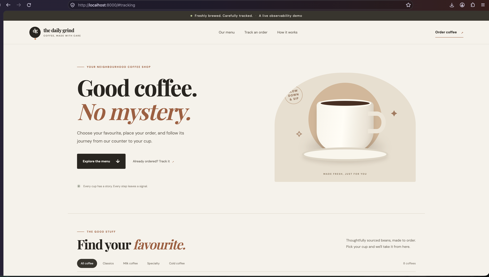

### Architecture

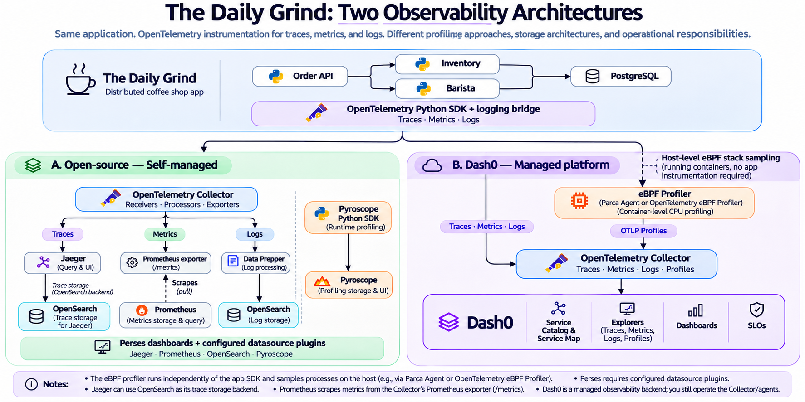

### Distributed traces in Jaeger

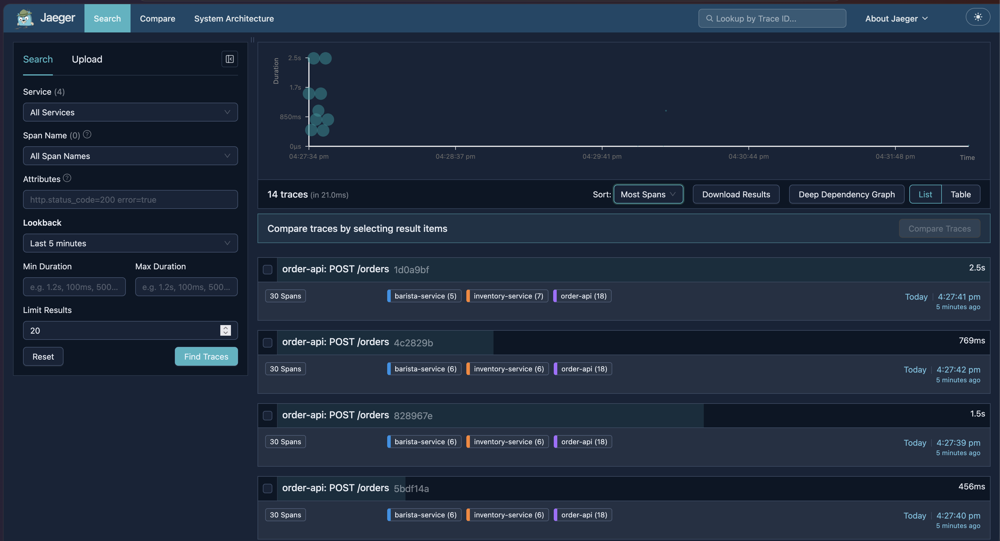

### Metrics in Prometheus

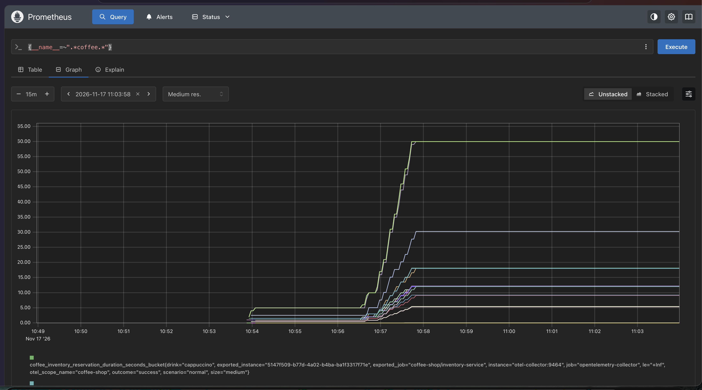

### Correlated logs in OpenSearch

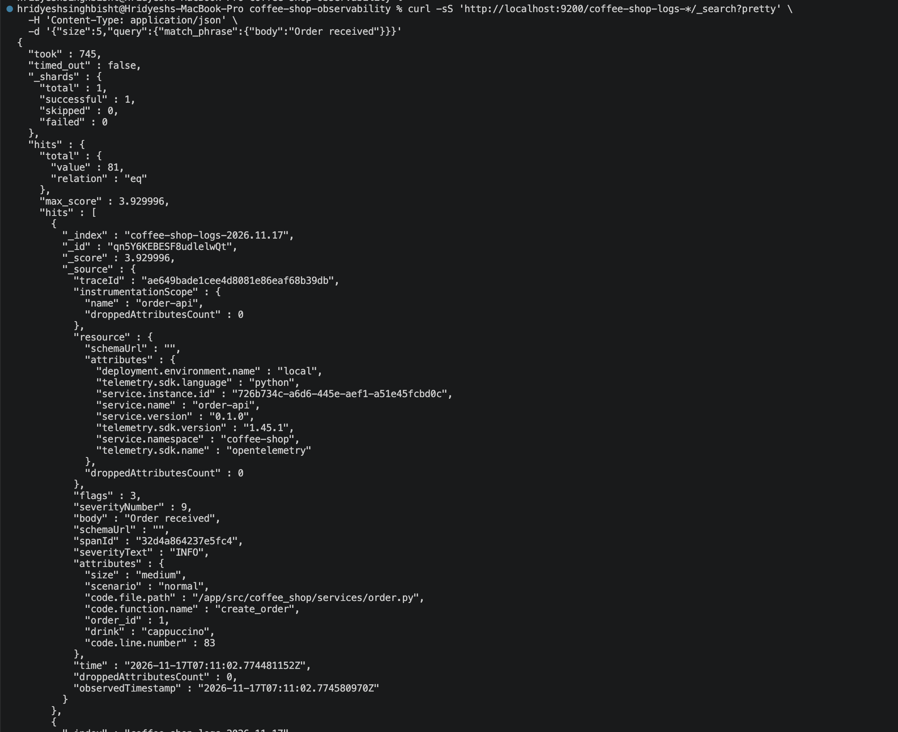

### Profiles in Pyroscope

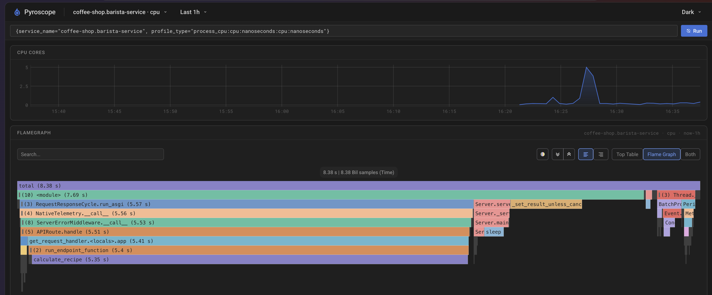

### Dashboard in Perses

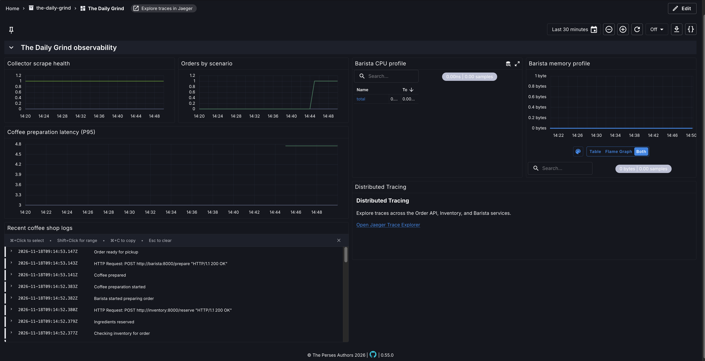

### Dash0 comparison

The same application telemetry can be explored in Dash0. These screenshots show the service inventory, service map, and dashboard. The profiling screenshot is an unfiltered Dash0 view; it does not identify a coffee shop service and should not be used as evidence of a Barista profile.

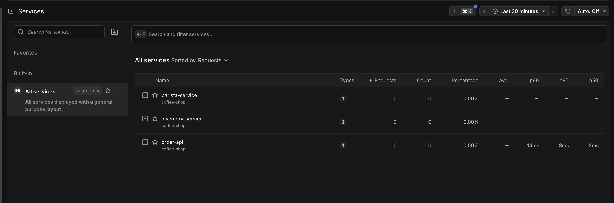

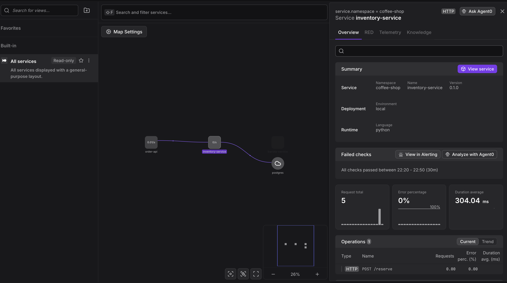

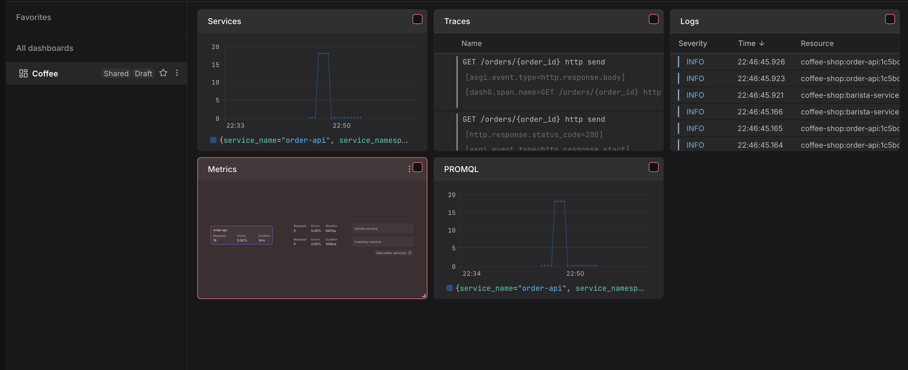

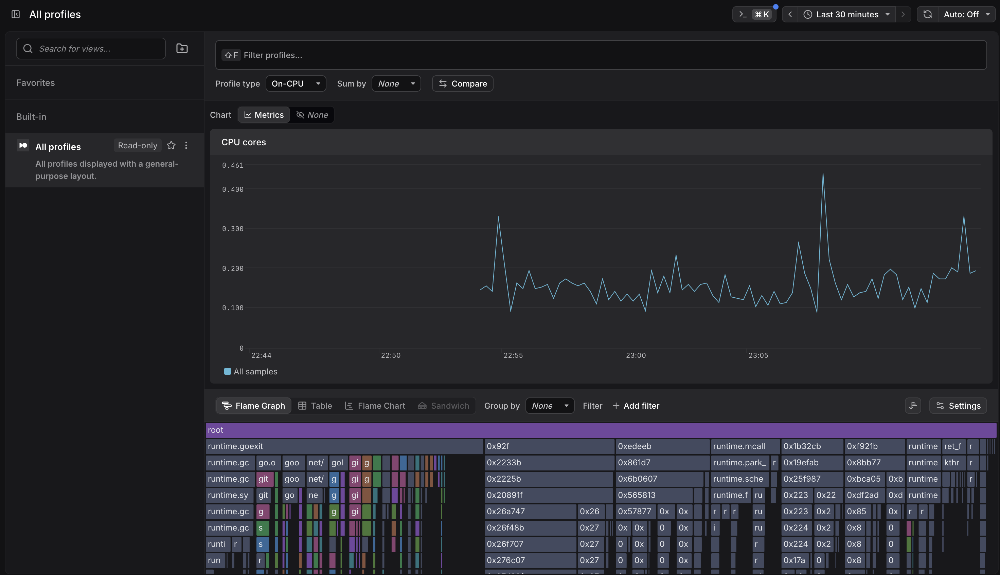

## Customer experience

- Browse espresso, Americano, cappuccino, latte, flat white, mocha, iced latte, and cold brew.
- Choose a small, medium, or large cup.
- Place an order and receive an order number immediately.
- Track the order as it moves through inventory and preparation.
- Use the local-only developer control to introduce predictable I/O, CPU, database, and memory scenarios.

## Architecture

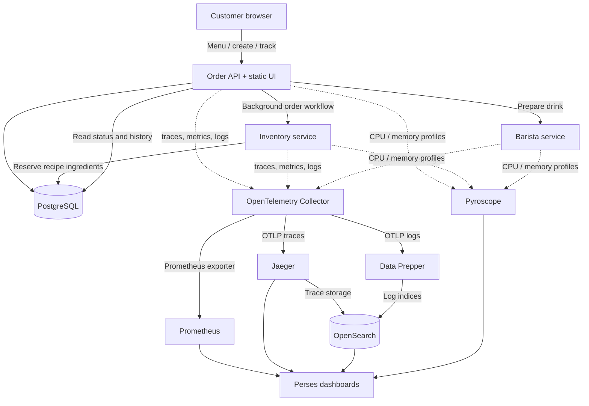

### Services

| Component | Responsibility |
|---|---|
| Customer UI | Menu, order placement, and order tracking; served by the Order API to keep the demo same-origin |
| Order API | Creates orders, maintains status history, and coordinates the workflow |
| Inventory | Checks and reserves the ingredients required by each drink |
| Barista | Simulates drink preparation and controlled performance scenarios |
| PostgreSQL | Source of truth for orders, inventory, and order status history |

### Observability components

| Component | Signal / responsibility |
|---|---|
| OpenTelemetry Python | Instrumentation and telemetry SDKs |
| OpenTelemetry Collector | Receives and routes traces, metrics, and logs |
| Jaeger | Distributed trace storage and exploration; uses OpenSearch storage |
| Prometheus | Scrapes and stores application metrics |
| OpenSearch + Data Prepper | Receives and indexes application logs; OpenSearch also stores Jaeger trace data |
| Pyroscope | Stores and explores CPU and memory profiles |
| Perses | Dashboards for Prometheus, Jaeger, OpenSearch, and Pyroscope |

**Important:** PostgreSQL is the source of truth for customer-visible order status. The UI reads the Order API; it does not query Jaeger, Prometheus, OpenSearch, or Pyroscope. OpenTelemetry helps developers understand what happened while the order moved through the services.

## Coffee menu

| Coffee | Base price | Main ingredients |
|---|---:|---|
| Espresso | $2.80 | Coffee beans |
| Americano | $3.20 | Coffee beans |
| Cappuccino | $4.20 | Coffee beans, milk |
| Caffè latte | $4.50 | Coffee beans, milk |
| Flat white | $4.60 | Coffee beans, milk |
| Mocha | $5.10 | Coffee beans, milk, chocolate syrup |
| Iced latte | $4.80 | Coffee beans, milk, ice |
| Cold brew | $4.40 | Coffee beans, ice |

The application adjusts price and ingredient quantities by cup size. Prices are demo values and can be changed in `src/coffee_shop/menu.py`.

## Order lifecycle

1. `POST /orders` validates the request, saves the order with `received` status, records the first history event, schedules the workflow, and returns HTTP `202` with the order ID.
2. The Order API updates the status to `checking_inventory` and calls Inventory.
3. Inventory reserves the ingredients in a PostgreSQL transaction.
4. The Order API records `ingredients_reserved` and `preparing`, then calls Barista.
5. Barista prepares the drink and returns the result.
6. The Order API records `ready`. If a downstream operation fails, it records `failed`.
7. The UI polls `GET /orders/{order_id}` and renders the current status and history.

The local demo uses FastAPI background tasks to keep the project small. These tasks run in the Order API process and are **not durable**: a process restart can interrupt an in-flight order. A production implementation should use a durable queue or workflow engine (for example, RabbitMQ) and idempotent consumers.

## Signals emitted by the application

### Traces

- FastAPI instrumentation creates server spans.
- HTTPX instrumentation creates client spans and propagates W3C trace context between services.
- Manual spans mark order creation, the order workflow, status updates, inventory reservation, PostgreSQL operations, and coffee preparation.
- The Collector exports traces to Jaeger. Jaeger persists them in OpenSearch.

### Metrics

The application records business metrics such as:

- `coffee.orders` — accepted orders.
- `coffee.order.duration` — background workflow duration.
- `coffee.order.status_changes` — lifecycle transitions.
- `coffee.inventory.reservations` — inventory reservation attempts.
- `coffee.inventory.reservation.duration` — reservation duration.
- `coffee.preparations` — preparation attempts.
- `coffee.preparation.duration` — preparation duration.

The Collector exposes OTLP metrics on port `9464`; Prometheus scrapes that endpoint every five seconds. FastAPI instrumentation also emits HTTP server metrics. Metric names are normalized by the Prometheus exporter; inspect `http://localhost:9464/metrics` or Prometheus to confirm the names in your pinned version.

Avoid using order IDs or customer IDs as metric labels. They create high-cardinality time series.

### Logs

Python's standard `logging` module produces application logs. The OpenTelemetry logging bridge adds trace and span context, and the OTLP exporter sends the records through the Collector to Data Prepper and OpenSearch. The application also writes logs to container stdout for local debugging.

**Stability note:** OpenTelemetry Python currently marks traces and metrics as stable and logs as development. This demo pins the SDK versions in `requirements.txt` so the log pipeline can be reproduced.

### Profiling

Each Python process uses the Pyroscope Python SDK to sample CPU and memory usage. Profiles go directly to Pyroscope through its native ingestion protocol, not through the OpenTelemetry Collector.

This SDK-based setup is portable across macOS and Linux. The eBPF profiler is a separate Linux-only option and requires additional host privileges. For the later Dash0 comparison, use an OTLP-native profiling path rather than assuming the Pyroscope SDK output can be forwarded unchanged.

## Run locally

### Prerequisites

- Docker Desktop or another Docker Engine with Docker Compose v2.
- At least 8 GB of memory available to Docker; OpenSearch and Data Prepper are the most memory-intensive services.

### Start the application

```bash
cp .env.example .env  # First run only; do not overwrite an existing .env
docker compose up --build -d
```

Check the containers:

```bash
docker compose ps
```

Open the customer UI:

- Coffee shop: http://localhost:8000/
- Order API documentation: http://localhost:8000/docs

Check service health:

```bash
curl http://localhost:8000/healthz
curl http://localhost:8001/healthz
curl http://localhost:8002/healthz
```

### Place an order from the command line

```bash
curl -i -X POST http://localhost:8000/orders \
  -H 'Content-Type: application/json' \
  -d '{"drink":"flat_white","size":"medium","scenario":"normal"}'
```

The API returns HTTP `202` and a JSON response containing `order_id`. Use that ID to retrieve the status:

```bash
curl http://localhost:8000/orders/1
```

### Developer performance scenarios

The local `.env.example` enables controlled scenarios for learning. Set `ENABLE_DEMO_SCENARIOS=false` before exposing the app publicly. The API rejects non-normal scenarios when this flag is disabled, and the UI hides the developer controls.

- `normal` — normal preparation path.
- `slow_io` — Barista waits asynchronously for 1.5 seconds; expect a slow span and relatively low CPU use.
- `slow_cpu` — Barista runs a bounded CPU-intensive calculation; inspect the preparation trace and CPU profile.
- `slow_db` — Inventory runs `SELECT pg_sleep(1.5)`; inspect the database span.
- `slow_memory` — Barista holds a bounded temporary allocation; inspect memory profiles.

These controls are for local development only. Do not expose them on a public demo.

### Run and validate all five scenarios

After the stack is healthy, run:

```bash
bash scripts/validate_scenarios.sh
```

The script submits the five scenarios one at a time, captures each `order_id`, polls `GET /orders/{id}` until the order reaches `ready`, and prints its lifecycle history. It verifies the application workflow; it does **not** by itself prove that Jaeger or OpenSearch received telemetry. Wait at least 10 seconds after it finishes so the SDK and Collector batch processors can export their data, then follow the trace and log checks below.

#### Verify traces in Jaeger

1. Open `http://localhost:16686`.
2. Select `order-api` as the service and choose a lookback window that includes the test run.
3. Find the traces and open one. Look for the `order.create` and `order.process` spans, plus HTTP client/server spans for Inventory and Barista.
4. Search by the `coffee.order_id` span attribute if you want to inspect a particular order.
5. Check the scenario-specific span:

| Scenario | Expected span or detail |
|---|---|
| `normal` | `barista.prepare` |
| `slow_io` | `barista.simulate_io_wait` (about 1.5 seconds) |
| `slow_cpu` | `barista.recipe_calculation` |
| `slow_db` | `postgresql.select`, with `db.collection.name=pg_sleep` (about 1.5 seconds) |
| `slow_memory` | `barista.temporary_allocation` |

The trace should show the same trace ID across the Order API, Inventory, and Barista service spans. If a downstream service appears as a separate trace, check that HTTPX instrumentation is enabled and that the `traceparent` header is propagated.

#### Verify logs in OpenSearch

First, confirm that the daily log index exists:

```bash
curl -sS 'http://localhost:9200/_cat/indices/coffee-shop-logs-*?v'
```

Then retrieve a few log records:

```bash
curl -sS 'http://localhost:9200/coffee-shop-logs-*/_search?pretty' \
  -H 'Content-Type: application/json' \
  -d '{"size":10,"query":{"match_phrase":{"body":"Order received"}}}'
```

Inspect each hit's `_source`. With the configured OpenTelemetry output format, check for the log body, `traceId`, `spanId`, resource attributes (including `service.name`), and log attributes such as `order_id`. Field names can vary if the Data Prepper output format or pipeline is changed.

To correlate a log with a trace, copy the trace ID from Jaeger and search OpenSearch:

```bash
curl -sS 'http://localhost:9200/coffee-shop-logs-*/_search?pretty' \
  -H 'Content-Type: application/json' \
  -d '{"size":20,"query":{"match":{"traceId":"PASTE_TRACE_ID_HERE"}}}'
```

A successful correlation returns log records with the same trace ID. Logs emitted inside active spans should also contain a span ID.

#### Useful checks if telemetry is missing

```bash
# Application and backend container state
docker compose ps

# Look for exporter, receiver, and indexing errors
docker compose logs --since=10m order-api inventory barista otel-collector jaeger data-prepper opensearch

# Check Collector health
curl -sS http://localhost:13133/

# Inspect exported Prometheus metrics
curl -sS http://localhost:9464/metrics | grep -E 'coffee_|http_server_'
```

If order status reaches `ready` but no traces appear, inspect the application and Collector logs first. If traces appear but logs do not, inspect the `logs` pipeline in `infra/otel-collector/collector.yaml`, Data Prepper logs, and the `coffee-shop-logs-*` index. If an index is absent, confirm Data Prepper is healthy and that its pipeline is listening on port `21890`.

## Explore the telemetry

| Tool | URL | What to inspect |
|---|---|---|
| Jaeger | http://localhost:16686 | Find the `order-api` trace and follow service spans |
| Prometheus | http://localhost:9090 | Query request, order, inventory, and preparation metrics |
| OpenSearch | http://localhost:9200 | Check cluster health and log indices |
| Pyroscope | http://localhost:4040 | Compare CPU and memory profiles by service |
| Perses | http://localhost:8080 | Configure datasources and build the coffee shop dashboard |

Create Perses datasources using these container-network URLs:

| Plugin | URL |
|---|---|
| Prometheus | `http://prometheus:9090` |
| Jaeger | `http://jaeger:16686` |
| OpenSearch | `http://opensearch:9200` |
| Pyroscope | `http://pyroscope:4040` |

For local experimentation, direct datasource URLs are convenient. For a shared deployment, configure authentication and reverse-proxy access rather than exposing backend services directly to browsers.

## Optional Dash0 export

The default stack keeps telemetry local. For an article comparison, `docker-compose.dash0.yml` fans out OTLP traces, metrics, and logs to Dash0 and the local backends. It also accepts OTLP profiles and forwards them to Dash0.

On a Linux Docker host, add `docker-compose.dash0-profiles.yml` to collect CPU profiles from the application processes with the OpenTelemetry eBPF profiler. The app's Pyroscope SDK continues to send its own CPU and memory profiles to Pyroscope; these are separate profile streams. eBPF profiling requires privileged Linux host access and is not supported by this setup on macOS Docker Desktop.

On macOS, export a merged profile already stored in Pyroscope. The Pyroscope UI in this stack may show individual profile IDs without an export action; use Grafana's `profilecli` to select a service and time range instead:

```bash
brew install pyroscope-io/brew/profilecli
PROFILECLI_URL=http://localhost:4040 profilecli query series --from="now-1h" --to="now"
PROFILECLI_URL=http://localhost:4040 profilecli query profile \
  --profile-type=process_cpu:cpu:nanoseconds:cpu:nanoseconds \
  --query='{service_name="coffee-shop.barista-service"}' \
  --from="now-1h" --to="now" \
  --output=pprof=./barista-cpu.pprof
```

If the series output shows a different `service_name`, use that value in `--query`. The command merges all matching profiles in the selected hour; no profile ID is needed. With the Dash0 override running, import the file through the Collector's localhost-only pprof receiver:

```bash
curl --fail-with-body --show-error \
  -X POST http://127.0.0.1:4041/v1/pprof \
  -H 'Content-Type: application/octet-stream' \
  -H 'Content-Encoding: gzip' \
  --data-binary @./barista-cpu.pprof
```

The command assumes the exported `.pprof` file is gzip-encoded; omit `Content-Encoding: gzip` if it is not. The pprof receiver converts the file to OTLP profiles and the Collector exports it to Dash0. This is a one-time import of the selected profile window, not continuous profiling. Check Dash0's **Telemetry > Profiling** view in the configured dataset. If the import fails, check `otel-collector` logs; do not send the `.pprof` file directly to Dash0's OTLP endpoint.

On first setup, create `.env` from the example. If `.env` already exists, edit it in place so your credentials are not overwritten:

```bash
cp .env.example .env  # First run only
```

```dotenv
DASH0_OTLP_GRPC_ENDPOINT=YOUR_DASH0_OTLP_GRPC_ENDPOINT
DASH0_AUTH_TOKEN=YOUR_DASH0_AUTH_TOKEN
DASH0_DATASET=default
```

Start the stack with the optional Dash0 override:

```bash
docker compose -f docker-compose.yml -f docker-compose.dash0.yml up --build -d --wait --wait-timeout 300
```

To send CPU profiles as well, run the stack on a Linux host:

```bash
docker compose -f docker-compose.yml -f docker-compose.dash0.yml -f docker-compose.dash0-profiles.yml up --build -d --wait --wait-timeout 300
```

Generate the same scenarios used in the local screenshots:

```bash
bash scripts/validate_scenarios.sh
python3 scripts/validate_e2e.py
for i in {1..5}; do bash scripts/generate_orders.sh; done
```

Wait 60-90 seconds for SDK and Collector batches to flush, then compare:

- Jaeger trace search vs. Dash0 tracing for `service.name=order-api`.
- Prometheus coffee metrics vs. Dash0 metrics for names beginning with `coffee.` or `coffee_`.
- OpenSearch trace-correlated logs vs. Dash0 logs filtered by `service.name` and `trace_id`/trace context.
- On Linux, look in Dash0's Profiling view for On-CPU profiles from `order-api`, `inventory-service`, and `barista-service`. Run repeated `slow_cpu` orders to produce a useful sample window.

Check Collector health and logs if data is missing:

```bash
curl -sS http://localhost:13133/
docker compose -f docker-compose.yml -f docker-compose.dash0.yml logs --since=10m otel-collector
```

On Linux, also check the profiler container if profiles are missing:

```bash
docker compose -f docker-compose.yml -f docker-compose.dash0.yml -f docker-compose.dash0-profiles.yml logs --since=10m otel-ebpf-profiler
```

Stop the Dash0 comparison stack with the same Compose files:

```bash
docker compose -f docker-compose.yml -f docker-compose.dash0.yml down
```

## Docker end-to-end acceptance

Run the automated workflow and telemetry checks after starting Docker:

```bash
docker compose up --build -d --wait --wait-timeout 300
python3 scripts/validate_e2e.py
```

This creates five orders and checks lifecycle history, distributed traces, correlated logs, and Prometheus metrics. Profiles and browser interactions require manual inspection. See [Docker validation results and runbook](docs/docker-validation.md) for prerequisites, coverage, limitations, and the recorded execution status. The Dash0 Collector has started and accepted a pprof upload locally; full end-to-end acceptance is still pending.

## Tests

The lightweight unit tests cover the menu, size-based prices and ingredients, and the bounded profiling workloads. They do not require Docker or the telemetry backends.

```bash
python -m pip install -r requirements-dev.txt
PYTHONPATH=src pytest -q
```

## Stop and reset

Stop the containers while retaining data:

```bash
docker compose down
```

Remove containers and stored data for a clean reset:

```bash
docker compose down -v
```

## Publishing and security

`.env`, `.env.*`, `.secrets/`, and `*.pprof` are ignored by Git; the Docker build context also excludes these files. Keep Dash0 tokens in the local `.env` file, never in screenshots or documentation. `.env.example` contains placeholders only.

Compose binds published ports to `127.0.0.1` for local use. This stack includes local-only database credentials, an unauthenticated OpenSearch instance, and optional performance scenarios. Do not deploy this Compose configuration publicly. The Linux-only eBPF profiling overlay is privileged and mounts the Docker socket; use it only on a trusted Linux host.

